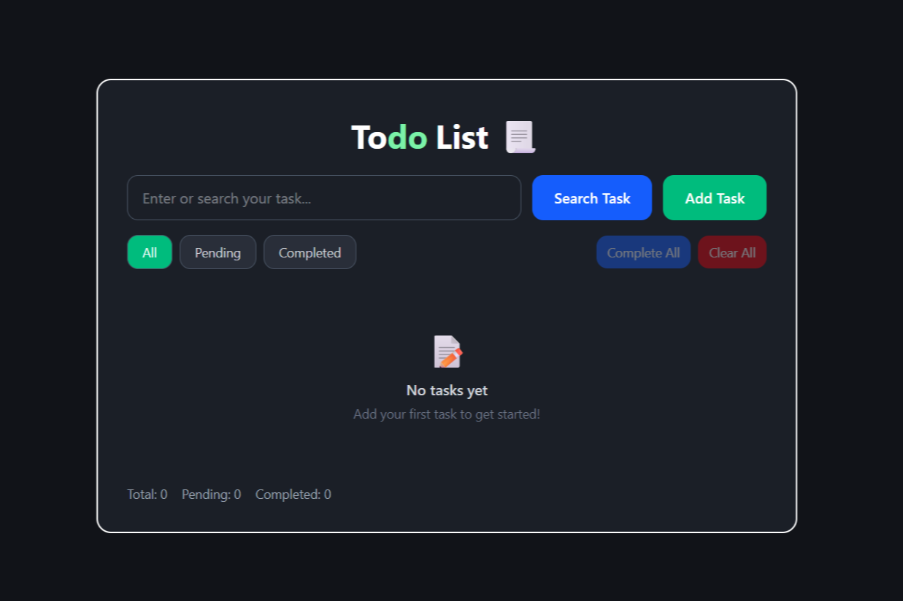

# Todo List App

A Todo List application built with **React** and **Vite**. It
helps users add, search, edit, filter, and manage daily tasks. Tasks are
saved in the browser using **localStorage**, so they remain available
after refreshing the page.

## Preview



## Features

-   **Add tasks** --- create new tasks from the input field.
-   **Search tasks** --- find tasks by their text.
-   **Edit tasks** --- update an existing task.
-   **Delete tasks** --- remove individual tasks.
-   **Task filters** --- view all, pending, or completed tasks.
-   **Complete tasks** --- mark tasks as completed and manage them
    together.
-   **Clear all tasks** --- remove tasks when needed.
-   **Task statistics** --- see total, pending, and completed task
    counts.
-   **localStorage persistence** --- tasks are saved in the browser and
    restored after refresh.
-   **Responsive UI** --- a clean interface with clear action
    buttons.

## Tech Stack

-   React
-   Vite
-   JavaScript
-   CSS
-   Browser localStorage

## Project Structure

``` text
TodoApp/
├── public/
├── src/
│   ├── assets/
│   ├── components/
│   │   ├── TaskFilters.jsx
│   │   ├── TaskForm.jsx
│   │   ├── TaskItem.jsx
│   │   ├── TaskList.jsx
│   │   └── TaskStats.jsx
│   ├── App.jsx
│   ├── index.css
│   └── main.jsx
├── .gitignore
├── eslint.config.js
├── index.html
├── package.json
├── package-lock.json
├── README.md
└── vite.config.js
```

## Getting Started

### Prerequisites

Install a current version of [Node.js](https://nodejs.org/) and npm.

### Installation

1.  Clone the repository:

    ``` bash
    git clone https://github.com/Amanv-08/todo-react.git
    ```

2.  Open the project directory:

    ``` bash
    cd TodoApp
    ```

3.  Install dependencies:

    ``` bash
    npm install
    ```

4.  Start the development server:

    ``` bash
    npm run dev
    ```

5.  Open the local URL shown in your terminal.

## How localStorage Is Used

The app stores task data in the browser's `localStorage`. When the app
loads, it reads the saved tasks; when the task list changes, it updates
the saved data. This allows tasks to persist across page refreshes in
the same browser.

> Note: localStorage is specific to the browser and device. It does not
> sync tasks across devices or user accounts.

## Available Scripts

-   `npm run dev` --- start the Vite development server.
-   `npm run build` --- create a production build.
-   `npm run preview` --- preview the production build locally.
-   `npm run lint` --- run ESLint checks.

## Author

**Aman Verma**

GitHub: [Amanv-08](https://github.com/Amanv-08)

Built as a React practice project to strengthen component design, state
management, array methods, and browser storage skills.

## License

This project is open-source and available for learning and personal use.
